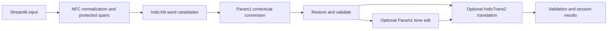

# Hinglish Smart Writing Assistant

CS3235 undergraduate mini-project: Roman Hindi → Devanagari, bounded contextual rewriting with BharatGen Param1, and Hindi → English with IndicTrans2. Pretrained inference only; no training, speech, OCR, RAG, accounts or database.

**Verification status (updated 6 November 2026):** the UI, real IndicXlit inference and **real IndicTrans2 translation through the local WSL worker are verified**, including the translation button. Model access and source inspection are complete for the pinned translation checkpoint. Param1's real tokenizer/chat template loads; pretrained Param1 generation remains blocked by available RAM. The original 50-case basic run completed 35 cases (34 scored generated results plus one Hindi passthrough). See `reports/verification.md` and `reports/translation_worker_verification.json`. Production adapters contain no mocked responses. Full three-model assessment remains incomplete while Param1 generation is unavailable.

## Run the UI on Windows

From this project directory in PowerShell:

```powershell
python -m venv .venv
.\.venv\Scripts\python.exe -m pip install -r requirements-ui.lock.txt
Copy-Item .env.example .env
.\.venv\Scripts\python.exe -m streamlit run app.py --browser.gatherUsageStats false
```

Open http://localhost:8501. The UI starts without loading model weights. Missing services produce actionable errors. Hindi-script basic conversion can pass through existing text without a model call; this is not evidence of model inference.

```powershell
.\.venv\Scripts\python.exe -m pytest -q
.\.venv\Scripts\python.exe -m pip check
.\.venv\Scripts\python.exe -m scripts.verify_integrations
.\.venv\Scripts\python.exe -m src.evaluation.run --variant context --out reports/evaluation-context
```

The last two commands explicitly save only the supplied public examples / evaluation cases, predictions and errors. The interactive app never saves input by default. JSON/TXT downloads are user initiated. Recent results are session only. Third-party model caches store downloaded model files outside Git.

## Model setup and access

### Windows UI with WSL translation (recommended on this machine)

IndicTransToolkit 1.1.1 has no Windows wheel and its source build requires Microsoft C++ Build Tools. A failed combined install can leave even Torch absent. Use the isolated local translator instead of repeatedly installing the same requirements into Windows:

1. Keep your accepted-model read token in `.env` and enable the reviewed pinned code as described below. Set `TRANS_URL=http://127.0.0.1:8766` in `.env`.
2. From the project folder in PowerShell, run `wsl -d Ubuntu -- bash scripts/setup_translation.sh`. It creates a separate Linux CPU environment, installs the official toolkit wheel and loads the same pinned IndicTrans2 weights. Wait for `IndicTrans2 ready at http://127.0.0.1:8766` and keep the terminal open.
3. In another terminal, restart the Windows UI using `.\.venv\Scripts\python.exe -m streamlit run app.py`. Its Windows environment needs only the UI requirements for this path. Use **Check translation worker** in the sidebar.
4. Enter Hindi text and click **Translate to English**. Roman Hinglish conversion additionally needs the separate IndicXlit worker on port 8765.

The local adapter verifies the worker's model ID and exact revision. It sends text only over local HTTP; the worker reads the token from the ignored `.env`, loads the real model in evaluation mode and performs the documented IndicTransToolkit preprocessing. It never substitutes a different model. Keep both services local. The first installation and model download can take several minutes. The Linux environment is temporary; dependency/model download caches persist outside Git.

Use Linux/WSL for the complete model environment. The UI-only Windows lock was installed and tested; the separate model environment is an integration target, not a verified full-stack lock. `requirements-models.txt` pins direct dependencies; run `pip check` after installation. Transformers 4.49.0 is selected because the pinned Param1 class inherits generation through PreTrainedModel, without explicitly inheriting GenerationMixin; newer Transformers removed that inheritance. This compatibility choice still needs pretrained inference verification. IndicTransToolkit may require a native build on Windows, hence Linux is recommended. No quantization is enabled. CUDA builds must match the installed driver; this machine reports `torch.cuda.is_available() == False`.

### 1. IndicXlit worker (separate Python 3.10 Linux environment)

The [official Python package](https://pypi.org/project/ai4bharat-transliteration/) supplies a Fairseq inference class in `transformer/custom_interactive.py`. The worker loads that unmodified class by file path, uses the published `__hi__` character preprocessing and v1.0 checkpoint, and parses its neural beam candidates. This avoids importing unrelated Urdu normalization and web dependencies from the high-level XlitEngine wrapper. This is real IndicXlit inference, with no vocabulary-based replacement for the model. Its Fairseq dependencies conflict with modern stacks, so the worker exposes only a small local JSON interface.

In Ubuntu/WSL, from the project directory:

```bash
python3.10 -m venv .venv-xlit
.venv-xlit/bin/python -m pip install 'pip==24.0' 'setuptools==69.5.1' 'wheel==0.43.0'
.venv-xlit/bin/python -m pip install --extra-index-url https://download.pytorch.org/whl/cpu -r requirements-xlit.txt
.venv-xlit/bin/python -m pip install --no-deps ai4bharat-transliteration==1.1.3
.venv-xlit/bin/python scripts/xlit_worker.py
```

Once the source build is available, `requirements-xlit-runtime.lock.txt` captures the installed CPU runtime. Reinstall it using `pip==24.0` and `pip install --no-deps --extra-index-url https://download.pytorch.org/whl/cpu -r requirements-xlit-runtime.lock.txt`. Source builds still need a C/C++ compiler; the recorded Fairseq wheel was built locally on Ubuntu/Python 3.10.

If `venv` reports missing ensurepip, install the distribution's Python 3.10 venv package, or bootstrap pip within a `--without-pip` environment using the official PyPA bootstrap script. `bash scripts/setup_xlit.sh` attempts a complete temporary CPU environment without system changes; it is an integration setup script, not a guaranteed successful install. Do not modify the global Python environment. First startup downloads upstream IndicXlit v1.0 weights into `~/.cache/hinglish-indicxlit-v1` (override with `XLIT_CACHE`). The archive SHA is recorded there after download. The published release is versioned; no publisher-provided checksum is assumed. The wheel is intentionally installed without its optional-to-this-path dependencies, so its full package metadata may make `pip check` report missing unrelated modules; the direct class requires Fairseq and Torch, not Urdu/TensorFlow/Flask. The complete UI environment does pass `pip check`.

Worker binds only to `127.0.0.1:8765`; `XLIT_URL` points there. WSL localhost forwarding must be enabled if the UI runs on Windows. For easiest networking run both UI and worker in Linux. Do not expose the worker publicly. Rescoring is disabled to avoid the extra dictionary; five neural candidates are returned.

The documented hosted API hostname failed DNS resolution in this session. No hosted fallback was enabled or assumed to be free.

### 2. Param1 and IndicTrans2

In a separate Python 3.11 Linux environment:

```bash
python3.11 -m venv .venv-models
.venv-models/bin/python -m pip install -r requirements-models.txt
.venv-models/bin/python -m pip check
.venv-models/bin/python scripts/inspect_models.py
```

For gated files, set `HF_TOKEN` privately in `.env` and accept the checkpoint conditions in your own Hugging Face account. Never put tokens in commands, commits, screenshots or reports. `scripts/inspect_models.py` reads `HF_TOKEN` from the environment / `.env`; downloaded code goes to ignored `reports/model_sources/`. Inspect that source at the pinned revisions, including tokenizer code and imports. Then set `ALLOW_REVIEWED_REMOTE_CODE=1` in `.env` and run the UI with `.venv-models/bin/python -m streamlit run app.py`.

For this direct Linux model environment, leave `TRANS_URL=` empty so translation runs in that environment. A nonempty `TRANS_URL` explicitly selects the separate worker. For the recommended Windows UI setup, keep `TRANS_URL=http://127.0.0.1:8766`.

| Role | Checkpoint / version | Access and license evidence |
| --- | --- | --- |
| Transliteration | [IndicXlit v1.0](https://github.com/AI4Bharat/IndicXlit), Python wrapper 1.1.3 | MIT; Hindi supported; about 11M parameters; legacy Fairseq stack |
| Context / phrasing | [bharatgenai/Param-1-2.9B-Instruct](https://huggingface.co/bharatgenai/Param-1-2.9B-Instruct) @ `f9b32a727458727ff515fea5d82df00ae9b7ad56` | Public, Hindi/English; custom code. Card metadata says Apache-2.0, prose says MIT, and no LICENSE file was listed. This discrepancy remains unresolved. Early research checkpoint; not established as a reliable editor. |
| Hindi → English | [ai4bharat/indictrans2-indic-en-dist-200M](https://huggingface.co/ai4bharat/indictrans2-indic-en-dist-200M) @ `d66a2122ad6d28184f3dc3797b652bd80ae3f65f` | MIT LICENSE retrieved; gated config/code returned HTTP 401 without accepted access. The model metadata has `inference: false`; no free hosted API is assumed. |

The official IndicTrans2 page now recommends the newer Indic-Translate family. We retain IndicTrans2 because it is the requested assessment stack, and use the documented `hin_Deva` → `eng_Latn` tags and IndicTransToolkit pre/postprocessing. The 200M distilled variant reduces memory needs compared with the 1B model. Param1's checked-in upstream config says 8192 positions, whereas its README says 2048; this app conservatively budgets 2048 including its prompt and output. Model provenance and source hashes are in `reports/model_metadata.json`.

Hardware observed: Windows build 26200, Python 3.11.5, 16,803,041,280 bytes RAM (~15.65 GiB), CPU-only PyTorch; free memory varied below 3 GiB. Ubuntu has Python 3.10.12 and roughly 7.6 GiB assigned. Approximate Param1 weight memory alone is 11.6 GB float32 or 5.8 GB half precision, before activations and runtime overhead. The app requires 13 GiB available for CPU float32 as a conservative estimate; this is not a measured inference requirement. GPU users may set `DEVICE=cuda` and supported `PRECISION=float16` or `bfloat16`; no VRAM requirement was measured here. The pool unloads the previous Transformers model before loading the next. Alternating models saves resident memory but can add repeated cold loads.

## Processing and integrity

### English translation setup error

`Pinned remote model code has not been enabled` means the model-code switch is off; it does not mean the translation model is otherwise ready. Changing that switch alone is insufficient.

1. Sign in to Hugging Face and accept the conditions on the [IndicTrans2 checkpoint page](https://huggingface.co/ai4bharat/indictrans2-indic-en-dist-200M).
2. Put a read token with access to that checkpoint in the ignored `.env` as `HF_TOKEN=...`. Do not share the token in chat or commit it.
3. Install `requirements-models.txt` in the **same environment that runs Streamlit**, following the Linux/WSL model setup above. The UI-only `.venv` does not include Torch, Transformers or IndicTransToolkit.
4. Run `python scripts/inspect_models.py` from that environment. Ensure the pinned translation Python/config files downloaded without HTTP 401/403 errors and inspect them under `reports/model_sources/indictrans2-indic-en-dist-200M/`.
5. Set `ALLOW_REVIEWED_REMOTE_CODE=1` in `.env`, stop Streamlit with Ctrl+C, and restart it using the model environment's Python. A browser refresh alone does not reload imported settings or replace cached resources.

First translation then downloads the model weights. Model access is tied to the account/token; this flag cannot bypass the publisher's gate. The initial verified setup had no token, and English translation was explicitly recorded as blocked.



IndicXlit supplies word candidates, not a sentence-level language identifier. The basic draft uses an editable vocabulary in `data/english_words.json`, leaves ambiguous `is/to/me/main/kal` unchanged, and retains clear English words for Natural Hinglish. Param1 sees the original sentence plus the draft to resolve context. Natural Hindi uses generative rendering, including translation of English words; it is never labeled pure transliteration. Unresolved ambiguity should remain; `kal` alone cannot determine yesterday versus tomorrow. Basic mode cannot claim contextual quality.

Protection covers URLs, emails, numeric expressions, capitalized Latin words, acronyms, hashtags and backtick-delimited code. Add lowercase names, Hindi names, organizations, dates containing words, or unmarked code via “Protect additional names / terms.” These are conservative heuristics, not named-entity recognition: capitalized English sentence starters can be overprotected and lowercase names missed. Explicit terms take precedence. Marker restoration rejects missing/duplicate markers. Rewriting prompts treat user JSON as data, never higher-priority instructions; this reduces but cannot eliminate prompt injection.

Each output is checked for protected content, numeric changes, emptiness, unusual expansion, script mismatch and possible negation loss. Failed validation retains the stage input and flags the failure. Numbers are compared lexically; translating digits into words intentionally fails this strict check. Negation checks are lexical proxies and may flag valid paraphrases. No deterministic check proves semantic equivalence or guarantees tense, intent, names or certainty. Human review remains required.

Translation operates around immutable spans to guarantee their restoration; this segmentation may reduce translation fluency. Blank lines are retained. Long inputs / model token budgets are rejected, never silently truncated. No user input is logged by the worker. Models are lazy, cached across reruns, evaluated under inference mode and deterministic decoding. Generation is bounded; incomplete generation is rejected. Each action is independent. Improve edits the current input; use full pipeline to improve the converted result. Translation selection is invalidated when input/settings change, preventing stale-result reuse.

## Evaluation and interpretation

`data/evaluation_cases.jsonl` contains 50 held-out cases in the required 10/10/8/7/5/5/5 categories. Three separate development inputs are in `data/development_cases.jsonl`. References are AI-authored drafts and **unreviewed**, with provenance and semantic constraints on every case. Five full-pipeline cases include English references. Do not use evaluation cases for routine prompt tuning or claim native-speaker validation.

```bash
python -m src.evaluation.run --variant basic --out reports/evaluation-basic
python -m src.evaluation.run --variant context --out reports/evaluation-context
python -m src.evaluation.run --variant rewrite --out reports/evaluation-rewrite
```

These commands record actual outputs; they may download weights and explicitly save the public evaluation inputs. `basic` uses the vocabulary-assisted IndicXlit draft; `raw_indicxlit` is separately retained in each prediction. `context` adds Param1 where conversion is requested. `rewrite` requests the full pipeline. Direct per-case actions remain in context/basic variants, so compare only shared successful cases rather than comparing unrelated aggregate denominators. Full generation ablation remains unmeasured until models run.

CER/WER use Levenshtein edit distance and the best accepted reference per metric. Normalization: NFC, Latin casefold, collapse whitespace; retain punctuation and Hindi marks. Macro averages weight cases equally; rates can exceed 1 for expansion. Exact matching undercounts valid free-form Hindi and equally valid paraphrases. English chrF uses SacreBLEU sentence scores against accepted references. Failed, rejected, and partial results are excluded from quality/preservation denominators and count as unsuccessful. Inspect denominator fields; zero coverage is not perfect quality.

The runner writes `predictions.jsonl`, `metrics.json` and `failure_analysis.json`. It records per-stage and total times; Transformers cold model-load seconds are separated from remaining work. Excluding-load timings include tokenization, validation-related overhead and inference; they are not kernel benchmarks. IndicXlit startup is printed by the worker and returned by its readiness route; its request time is warm inference only if the worker was already loaded. Measured startup and basic-mode request latency are in `reports/verification.md`; Param1 and IndicTrans2 latency remains unmeasured. Hardware is recorded with each run.

Human review: score meaning, grammar, fluency and tone 1–5 (1 unusable, 3 partly acceptable, 5 fully acceptable); mark unsupported additions yes/no, and entities/numbers/negation/tense preserved yes/no/uncertain. Read the original alongside all intermediate outputs. For translation also score adequacy and fluency 1–5. Do not fill these fields automatically. `human_review` stays null until reviewed.

Supplementary [Aksharantar](https://huggingface.co/datasets/ai4bharat/Aksharantar) metadata was checked. Its card metadata labels the license only `cc`; a precise variant was not verified, so no subset was redistributed or benchmark score claimed. Verify the distribution's exact license and held-out Hindi split before adding it. Word accuracy would not establish sentence-level Hinglish quality. The supplied older IndianNLP URL redirects to the archived IndicNLP-Transliteration repository; current modeling work uses IndicXlit.

## Verification, failures and limits

See `reports/verification.md` and `reports/failure_analysis.md` for actual results. Both observed IndicXlit errors and remaining resource/access blockers are recorded. Param1/IndicTrans2 execution, three-way quality comparison and human reference review remain required before claiming full assessment completion. Browser automation was unavailable; Streamlit AppTest executes the actual UI script, and the live HTTP server was checked. `scripts/check_live_ui.py` specifically exercises the conversion action against the real worker, separately from mocked unit tests.

Next improvements after access is resolved: human-review the references, measure all real inference cases, analyze shared successful ablations, improve ambiguous code-switch handling using the development set, and verify model licenses with the publisher. Do not add unrelated functionality.

## Demonstration (3–5 minutes)

1. 0:00–0:40: Explain code-switching, script conversion versus translation, and the three pretrained model roles. Show readiness and current verification limitations.
2. 0:40–1:30: Run `mujhe kal college jana hai`; inspect IndicXlit candidates, ambiguity warning and context output. Compare “जाना है” modality against the source. If blocked, show the actual error, not an invented answer.
3. 1:30–2:20: Try `maine assignment submit nahi kiya`, retaining English in Natural Hinglish; inspect negation. Contrast Natural Hindi only if Param1 is operational.
4. 2:20–3:10: Enter Hindi and run Formal improvement. Check for added reasons/promises and certainty changes. Translate the selected result when access is available.
5. 3:10–4:00: Use the Naman/date and email examples; inspect exact protected spans. Show copy, JSON export and reset.
6. 4:00–4:40: Show actual evaluation denominators, unreviewed references, human-review rubric and recorded failures. Distinguish unit tests from real integration evidence.

## Assessment mapping

| Requirement | Deliverable |
| --- | --- |
| Problem/relevance and selection rationale | README processing/model sections |
| End-to-end architecture and genuine AI interfaces | `src/pipeline.py`, `src/models/`, isolated worker (execution blocked where documented) |
| Mixed-language processing and safeguards | preprocessing, editable vocabulary, contextual prompt, validation |
| Usable frontend and demonstration | `app.py`, demonstration script above |
| Quantitative testing and failure analysis | held-out JSONL, evaluation CLI, actual reports |
| Meaningful automated verification | `tests/`, Streamlit AppTest, integration probe |
| Reproducibility and repository quality | pinned model SHAs, UI lock, setup docs, `.gitignore` |

## GitHub preparation

No remote is created and nothing is published. After reviewing files and ensuring reports contain only public examples:

```powershell
git init
git add .
git status --short
git commit -m "Implement Hinglish writing assistant with explicit model verification"
git branch -M main
# Create your own empty GitHub repository, then:
git remote add origin https://github.com/YOUR_USERNAME/hinglish-smart-writing-assistant.git
git push -u origin main
```

Never add `.env`, model weights, caches, virtual environments, authentication files or private inputs. Inspect `git diff --cached` before committing. Model and dataset licenses remain separate from application code.
